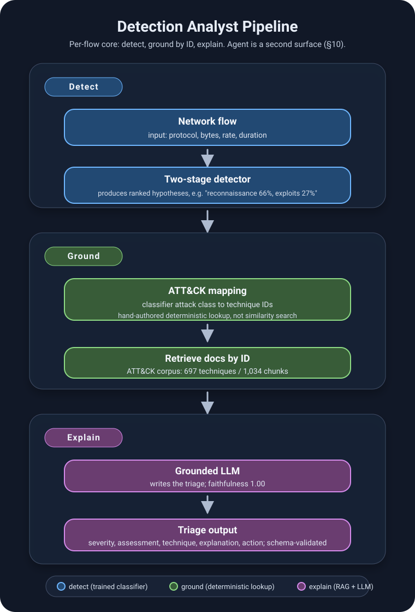

# Detection Analyst

Network intrusion detection with an investigation agent. Upload a pcap, get
alerts from two detectors, and ask an agent to investigate them. The agent uses
MCP tools, grounds every claim in tool results and MITRE ATT&CK, and files
triages for a person to review.

**Public demo:** https://detection-analyst-701568797950.us-west1.run.app/ (8 questions per visitor, no uploads; uploads need an
access code).



The project is a sequence of measured experiments. Rules and pass criteria are
written down before each run, held-out data is kept for testing, and failed
results are reported next to the ones that worked.

## What it does

| Part | What it does | Code |
|---|---|---|
| Feature extraction | Rebuilds UNSW-NB15's 42 flow features from any pcap with Zeek | `src/ingest/` |
| Per-flow model | Two-stage gradient boosting: attack or benign, then attack type | `src/detect/two_stage.py` |
| Behavioral rules | Port scans, network sweeps, floods, brute force and DNS bursts, counted across a host's flows; nothing trained | `src/detect/behavior.py` |
| ATT&CK grounding | Attack type to technique IDs from a hand-written table; docs fetched by exact ID | `src/mapping.py`, `src/rag/` |
| Investigation agent | Claude with read-only MCP tools, skills, and guardrails enforced in code | `src/agent/` |
| Web app | Chat, alert rail, uploads (up to 2 GB), triage review; Cloud Run | `src/agent/web.py` |

## Key results

| Result | Number | Details |
|---|---|---|
| Per-flow model, UNSW-NB15 held-out test set | 93.1% of attacks caught, 6.9% false-positive rate | [detector.md §2](docs/detector.md) |
| Explanation faithfulness (cited techniques present in retrieved context) | 1.000 on 80 alerts | [detector.md §2](docs/detector.md) |
| Zeek features vs UNSW's own, same flows | 99.6% decision agreement | [parity.md](docs/parity.md) |
| Per-flow model on a different network (CIC-IDS2017) | Does not transfer: 55-74% of innocent flows flagged | [cic_eval.md](docs/cic_eval.md) |
| Behavioral rules on CIC-IDS2017 | PortScan 99.8%, DDoS 100%, DoS Hulk 99.8%; slowloris 0% | [behavior.md](docs/behavior.md) |
| Model trained on two networks | Failed its frozen pass rule; not deployed | [model_v2.md](docs/model_v2.md) |
| Agent, held-out simulated day | 21/27 graded, 25/27 correct in substance; benign hosts 6 of 6 | [agent.md](docs/agent.md) |
| Agent, leading and pressure questions | Never accepted a false premise in 66 questions; one softened verdict | [phase_b.md](docs/phase_b.md) |

**Limits, stated up front.** The per-flow model was trained on one lab network
and does not generalize to others; on uploaded traffic from elsewhere, trust the
behavioral rules more than the model. The agent's evaluation runs on simulated
days built from one dataset. This is a research prototype, not a deployable IDS
([detector.md §6](docs/detector.md)).

## The agent

The agent investigates the way an analyst would: it lists correlated events,
pulls a host's activity to settle a split hypothesis (worm or backdoor?), looks
up ATT&CK techniques, and submits a schema-validated triage. Guardrails live in
code, not in the prompt:

- It can only cite techniques the detector proposed and that it retrieved this
  session.
- "No technique mapping" cannot become "benign" without a reason.
- Text from traffic is returned as labelled, untrusted data.
- It is read-only. Triages wait for a person; every tool call is audited.

The same MCP server runs in the CLI, the web app, Claude Code and Claude
Desktop. Full design, guardrails and eval history: [docs/agent.md](docs/agent.md).

## Running it

```bash
python3.12 -m venv detection_analyst
source detection_analyst/bin/activate
pip install -r requirements.txt
cp .env.example .env          # add ANTHROPIC_API_KEY

python -m src.corpus                                   # ATT&CK corpus
python -m src.rag.index                                # FAISS index
python -m src.detect.two_stage --train --threshold 0.85
python -m src.agent.scenario --mode real               # simulated investigation day
python -m src.agent.cli -v                             # chat with the agent
python -m pytest tests                                 # no API key needed
```

Score a pcap (needs Zeek): `python -m src.ingest.score --help`. Run the web app
locally: `DA_ALLOW_NO_AUTH=1 uvicorn src.agent.web:app --port 8080`. Deploying
to Cloud Run: [docs/deploy.md](docs/deploy.md).

## Data

- **UNSW-NB15** (Moustafa & Slay): flow CSVs, raw pcaps, ground-truth table.
  Not redistributed; place the files in `data/raw/`.
- **CIC-IDS2017** (Canadian Institute for Cybersecurity): pcaps and labelled
  CSVs, used only for testing on a different network.
- **MITRE ATT&CK Enterprise**: STIX 2.1, 697 active techniques.

## Repository layout

```
src/
├── ingest/     pcap -> Zeek -> 42 features; scoring uploads; CIC-IDS2017 evaluation
├── detect/     two-stage model, behavioral rules, correlation, ablations, model v2
├── agent/      MCP server, tools and guardrails, agent loop, web app, evals
├── rag/        ATT&CK chunking, index, generator
├── eval/       retrieval and explanation metrics
├── pcap/       payload extraction and labelling (detector.md §4.2)
├── mapping.py  attack type -> ATT&CK techniques
└── pipeline.py per-flow path: detect -> map -> retrieve -> explain
.claude/skills/ investigate-event, disambiguate-hypotheses, write-incident-report
tests/          pytest; ingest tests on synthetic pcaps need Zeek
data/scenario*/ simulated investigation days (dev, heldout, heldout2)
```

## Documentation

| Doc | What is in it |
|---|---|
| [detector.md](docs/detector.md) | The per-flow model: evaluation design, experiments (including negative results), operating point, production gap |
| [parity.md](docs/parity.md) | Rebuilding UNSW's features with Zeek, and proving they match |
| [upload.md](docs/upload.md) | Scoring uploaded pcaps and the per-capture false-positive baseline |
| [cic_eval.md](docs/cic_eval.md) | Testing on CIC-IDS2017, and the TTL shortcut the model learned |
| [behavior.md](docs/behavior.md) | Behavioral rules v1 to v5, each frozen before a held-out day |
| [model_v2.md](docs/model_v2.md) | Training on two networks: plan, results, ablation |
| [agent.md](docs/agent.md) | The agent: design, guardrails, skills, production logs, evals |
| [phase_b.md](docs/phase_b.md) | The agent that acts: leading-question eval, action tiers with approval |
| [deploy.md](docs/deploy.md) | Cloud Run, Secret Manager, access codes, public demo |

Results are recorded in the matching doc. This page changes only when a headline
changes.
